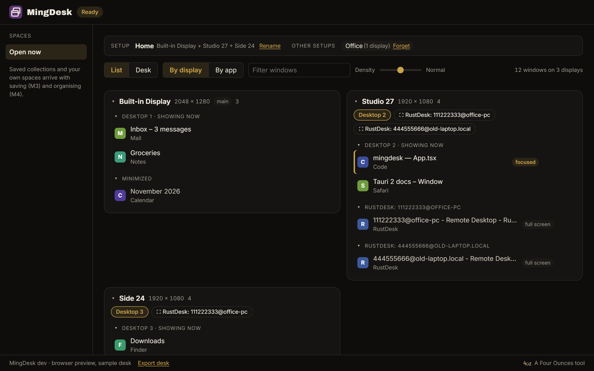
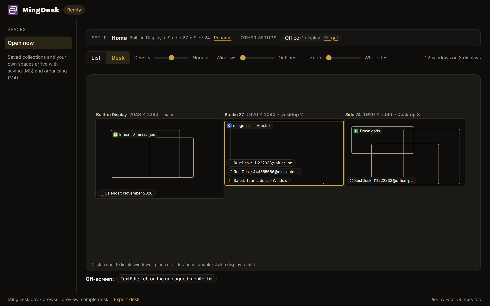

  

<h1 align="center">MingDesk</h1>

  Every app window on your computer, on one board. 
  For macOS and Windows. Free and open source (MIT).

  <a href="https://github.com/kratner/mingdesk/releases/latest"><strong>Download</strong></a> ·
  <a href="CHANGELOG.md">What's new</a> ·
  <a href="PLAN.md">The plan</a>

---

MingDesk shows every window you have open, on every display and desktop, as a list or as a picture of your
screens. Click one to go to it. Later versions will let you rearrange windows by dragging them, and save sets of
windows ("Quarterly report": a spreadsheet, two folders, a browser window, a terminal) into collections you can
search and bring back the way they were.

The name comes from 明窗淨几 (*míng chuāng jìng jī*), "a bright window and a clean desk": the classical picture of
a tidy place to work. It's a [Four Ounces](https://fourounces.live/) tool, a sibling of MingTab, which does the
same for browser tabs.

**Status: M1 preview (0.2.7).** MingDesk sees your desk and acts on single windows. It doesn't move, save or
restore windows yet. See the [roadmap](#roadmap).

## What it does now

  
   <em>List view: one section per display, windows front to back.</em>

  
   <em>Desk view: your displays to scale, with their windows.</em>

(Screenshots show the built-in sample desk, not a real one.)

- **The whole desk, live.** Every window on every display, front to back, kept up to date as windows open,
  close, move and change, and as you switch desktops or plug in displays. Minimized windows, windows on other
  desktops (and on macOS, full-screen spaces) are listed too.
- **Two views.**
  - **List:** a section per display, or grouped by app. Has a filter and density settings.
  - **Desk:** your displays drawn to scale in their real arrangement, with their windows as outlines. Zoom with a
    pinch, Ctrl+wheel or the slider. Move around with two fingers, or with Ctrl+drag on a mouse. Click a spot to
    list every window stacked there.
- **Act on windows.** Click to bring a window to the front (restoring it if minimized); minimize or close on
  hover; bring all of an app's windows forward.
- **Display setups.** MingDesk remembers each set of displays you use together (say, "Home" and "Office").
  A monitor that's missing from the current setup shows as a ghost.
- **Export desk** saves a snapshot of your windows as JSON, for trying board designs against a real desk. It
  holds real window titles, so it stays on your computer unless you share it.

**Private by design.** MingDesk reads window titles and positions to draw the board, and nothing leaves your
computer: there are no accounts, no analytics and no network calls.

## Download

Get the latest from [Releases](https://github.com/kratner/mingdesk/releases). Each release's notes have the
install steps.

| | File | Needs |
|---|---|---|
| **macOS** | `MingDesk-…-universal.dmg` | macOS 10.14 Mojave or later; Apple silicon or Intel |
| **Windows** | `MingDesk-…-x64-setup.exe` | Windows 10 or 11, 64-bit (Intel or AMD) |

Neither download is signed through a paid programme yet, so the first launch asks you to confirm:

- **macOS:** MingDesk is signed with Four Ounces' own certificate. On macOS 15 and later, open **System
  Settings → Privacy & Security** and click **Open Anyway**. On macOS 14 and earlier, Control-click MingDesk in
  Applications and choose **Open**. Then allow MingDesk under **Accessibility** when it asks: that's what lets it
  see and focus other apps' windows.
- **Windows:** SmartScreen says it protected your PC. Click **More info**, then **Run anyway**. Windows asks for
  no permission. MingDesk lives in the tray by the clock: left-click its icon to open the board, right-click for
  Quit.

## Roadmap

| | Milestone | |
|---|---|---|
| M0 | Skeleton: the app, its icon, macOS onboarding | Done |
| **M1** | **See your desk**: List and Desk views, live; focus, minimize, close; a quick switcher on a hotkey (⌥Space on macOS, Ctrl+Alt+Space on Windows) | Released on macOS and Windows, except the switcher |
| M2 | Arrange your desk: drag windows between displays, move and resize them on the Desk view | |
| M3 | Save and restore: collections of windows that reopen their apps and documents and go back where they were | |
| M4 | Organise: spaces, tags, stars, notes, search, as in MingTab | |
| M5 | Tabs: browser tabs (through MingTab), Finder, Terminal and VS Code | |
| M7 | Linux: X11 first | |

[PLAN.md](PLAN.md) has the detail: what each platform allows, the decisions so far, and how several displays
and desktops are handled.

## How it works

MingDesk is a [Tauri 2](https://tauri.app) app: a small Rust core that talks to the operating system, and a React
board. Each OS has its own implementation of one `Platform` trait (`src-tauri/src/platform/`):

- **macOS** uses the Accessibility API for titles and actions, and CoreGraphics for the stacking order and
  displays. A few private calls show which desktop and full-screen space each window is on.
- **Windows** uses Win32: it lists top-level windows front to back, gets their frames from DWM, and watches them
  through WinEvent hooks. Desktop membership comes from the virtual-desktop manager. Win32 needs no permission
  to see or focus other apps' windows.

The board's logic (which display a window belongs to, display setups, ghosts, what's covered) lives in
`src-tauri/src/desk.rs`. It doesn't call the OS, so it's unit-tested over a fake platform.

## Build it

You need [Node.js](https://nodejs.org) and Rust ([rustup.rs](https://rustup.rs)) on every platform, then
`npm install` in the repo.

### macOS

1. Install the Xcode command-line tools: `xcode-select --install`.
2. Once per Mac: `sh scripts/dev-cert.sh`. It adds a free, self-signed "MingDesk Dev" certificate to your login
   keychain, so every build has the same signature and macOS keeps the Accessibility permission between builds.
   The first build after it may ask to use the key: enter your login password and click **Always Allow**.
3. `npm run app -- --open` builds `MingDesk.app` (in `src-tauri/target/release/bundle/macos/`) and opens it.

`npm run tauri dev` gives a live-reloading board for UI work. Check the Accessibility steps with the built app,
though: under `tauri dev`, macOS charges the permission to whatever launched it (VS Code or Terminal).

### Windows

1. Install [Visual Studio Build Tools](https://visualstudio.microsoft.com/visual-cpp-build-tools/) with
   **Desktop development with C++** (or `winget install Microsoft.VisualStudio.2022.BuildTools` with the C++
   workload). WebView2 is already part of Windows 10 and 11.
2. `npm run tauri dev` runs MingDesk with a live-reloading board; `npx tauri build --bundles nsis` builds the
   installer into `src-tauri/target/release/bundle/nsis/`.

### The board in a browser

`npm run dev`, then open <http://localhost:1420>. Outside the app the board shows a sample desk, so you can work
on the UI without touching real windows. Add `?mock=crowded`, `ghost` or `office` for other sample desks,
`?view=desk` for the Desk view, or `?snapshot=<file>` to load an exported desk from `snapshots/` (git-ignored,
because exports hold real window titles).

### Tests

- `npm test` runs the Rust tests (`cargo test`). They cover the board's logic over a fake platform, plus each
  OS's own rules.
- `npm run build` type-checks and builds the board.
- On a real desk, these read without changing anything:
  - macOS: `cargo test probe_this_mac -- --ignored --nocapture`
  - Windows: `cargo test probe_this_pc -- --ignored --nocapture`
- End-to-end, on windows each test opens itself:
  - macOS: `cargo test watch_hears_its_own_textedit_windows -- --ignored --nocapture`
  - Windows: `cargo test e2e_own_explorer_windows -- --ignored --nocapture --test-threads=1`

  These take focus while they run.

### Releases

Bump the version in `package.json`, `src-tauri/Cargo.toml` and `src-tauri/tauri.conf.json`. Give it a section
in CHANGELOG.md ("preview" in its heading makes a pre-release), commit, then tag `vX.Y.Z` and push the tag.

The Release workflow (`.github/workflows/release.yml`) then does the rest, testing and building on both
platforms:
- On macOS it builds the universal app, signs it with the "MingDesk Dev" certificate, makes the .dmg and
  creates the release.
- On Windows it builds the NSIS installer and adds it to the same release.

A manual run (Actions → Release → Run workflow) builds both as downloads and publishes nothing. Once per repo,
give the workflow the certificate: `scripts/set-release-secrets.sh` says how.

### Icons

`npm run icons` rebuilds every icon from `branding/mingdesk.svg`. That file is copied from the Four Ounces kit
(kratner/four-ounces-brand, `logo/products/mingdesk.svg`), so change the glyph in the kit first, then copy it
here.

## Licence

MIT: see [LICENSE](LICENSE). The bundled fonts keep their own OFL licences (`public/fonts/licenses/`).

---

  <a href="https://fourounces.live/">A Four Ounces tool</a> · by Keith Ratner

